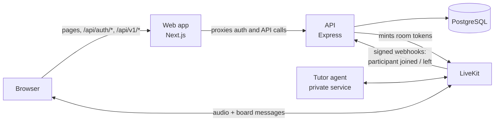

# Becan

Becan is a voice tutor for university students. A student picks a course their university
teaches, opens a chapter, and a tutor explains it out loud, writes on a board as it goes, and
asks questions to check the student understood. The student can interrupt and ask by voice.

This repository is the product's web app and API:

- [`frontend/`](frontend) — the web app (React 19 with Next.js 16, TypeScript, Tailwind CSS).
- [`backend/`](backend) — the REST API (Express 5, TypeScript, PostgreSQL with Drizzle ORM,
  Better Auth).

**Live demo:** [LIVE URL — I'll add after deploying]

## My role

Becan is a startup, and I was its software engineer. I built the backend and the web app in this
repository:

- The **authentication system**: email and password sign-up and sign-in, password reset, email change, account deletion, TOTP two-factor authentication, and an admin
  role with permission checks and an audit log.
- The **REST API**: the course catalog, enrollments, plans with per-period usage limits
  ("allowances"), and issuing the tokens that start a tutor session.
- The **database schema and migrations**, and the test suite that covers the API (30 test files
  run against a real PostgreSQL database).
- The **web app**: sign-up and sign-in flows, the catalog, the student dashboard, the account
  page, and the live session screen that connects to the tutor and renders its board.

The tutor itself (the AI agent that speaks and writes on the board) is a separate, private
service. It is not in this repository; see [Architecture](#architecture) for how the two meet.

## Architecture



- **The browser only talks to the web app.** Next.js proxies `/api/auth/*` and `/api/v1/*` to the
  Express API (`frontend/next.config.ts`). The session cookie is therefore first-party, and the
  API never has to accept cross-site credentials.
- **The API owns all state**: accounts, sessions, the catalog, enrollments, plans and usage.
  It follows a routes → controllers → services → repositories layering (`backend/src`).
- **The tutor agent is a separate private service** that this code never calls directly. The two
  meet in a LiveKit room:
  1. The student asks the API for a session (`POST /api/v1/livekit/token`). The API checks the
     enrollment and the plan's remaining allowance, records a study session, and returns a
     LiveKit token.
  2. The token carries participant attributes (course, chapter, language, how many seconds the
     session may last). That attribute set is the contract with the agent, which joins the same
     room, reads them, and teaches.
  3. The agent sends audio and board updates through the room; the web app renders them
     (`frontend/src/components/session`, `frontend/src/lib/session`).
  4. LiveKit reports joins and leaves to the API through signed webhooks. Usage is measured from
     those, never from anything the browser claims.

  Design notes for these decisions are in [`backend/docs/adr`](backend/docs/adr), and the domain
  vocabulary used in code and comments is in [`backend/docs/glossary.md`](backend/docs/glossary.md).

## Authentication

Authentication is built on [Better Auth](https://www.better-auth.com), mounted in Express at
`/api/auth/*` and configured in [`backend/src/lib/auth.ts`](backend/src/lib/auth.ts). Sessions are
stored in PostgreSQL and carried by an HTTP-only cookie.

**How it works**

| Flow | What happens |
|---|---|
| Sign up | Two steps: name, email and password, then phone number, university and major. Creating the account signs the student in; there is no email verification step. |
| Sign in | Email and password. |
| Two-factor | Accounts with TOTP enabled complete a second step (authenticator code or backup code) before a session exists. Repeated wrong codes lock the step temporarily. |
| Password reset | An emailed link sets a new password and signs the account out everywhere. |
| Account changes | Change email (confirmed from the new address), change password, update profile, delete account (typed confirmation plus password). |
| Sessions | 30-day sessions, refreshed daily. Signing out or resetting the password ends them. |

**Design decisions**

- **Same-origin proxy instead of cross-origin API calls.** The web app forwards auth requests to
  the API, so the cookie is first-party (no third-party-cookie problems), CORS is limited to
  exactly the known app origins with credentials on, and Better Auth's origin check stays enabled
  as CSRF protection.
- **Protected routes read the session from the database, not the cookie cache.** Better Auth caches
  the session in the cookie for five minutes to save lookups. `requireSession` and `requireAdmin`
  bypass that cache, so a ban, a role change or a revoked session takes effect on the very next
  request.
- **Account rules live in database hooks, not in one endpoint.** A phone number must be a valid,
  unique mobile number and the major must belong to the chosen university. Those checks run on
  every create and update, so they hold whether the row was written by sign-up, an account
  update, or an admin action.
- **Admins are a role on the same account, checked by permission.** Code asks "may this account
  do X", never "is the role admin". Every admin route needs the permission *and* two-factor
  enabled; removing an account or changing a role also needs a session created in the last ten
  minutes
  ([ADR 0002](backend/docs/adr/0002-admin-is-a-role-on-the-account-checked-by-permission.md)).
- **Every admin action is written to an audit log** in our own table, and removing an account
  scrubs that person's details from earlier entries
  ([ADR 0003](backend/docs/adr/0003-own-audit-log-not-better-auth-infrastructure.md)).
- **Rate limits per endpoint.** Sign-in, sign-up, password reset and email change each have
  their own limit, stored in the database so they hold across instances. API routes have a global
  limit and per-account limits on writes.
- **Emails are sent without blocking the response**, so response time does not reveal whether an
  address has an account.
- **The web app guards pages twice.** A lightweight check (`frontend/src/proxy.ts`) redirects
  visitors without a session cookie to sign-in. Each protected page then verifies the session with
  the API before rendering (`frontend/src/lib/auth/session.ts`), since a cookie's presence proves
  nothing.

## REST API

All routes are under `/api/v1` and return JSON. Errors have one shape:
`{ "error": { "message": "...", "code": "NOT_ENROLLED" } }`, where `code` is stable and the web app
maps it to what the student sees. Request bodies and queries are validated with Zod.

**Public**

| Method | Path | Description |
|---|---|---|
| GET | `/health` | Liveness check. |
| GET | `/plans` | The plans on offer, with their price and limits. |
| GET | `/institutions` | Universities and their majors, for sign-up. |
| GET | `/courses` | The course catalog. Optional `?institution=` filter. |
| GET | `/courses/:courseId` | One course with its chapters. |

**Signed-in student**

| Method | Path | Description |
|---|---|---|
| GET | `/me/enrollments` | The student's active enrollments. |
| PUT | `/me/enrollments/:courseId` | Enroll. Idempotent: `201` when created, `200` when already enrolled, `409 ENROLLMENT_LIMIT_REACHED` when the plan's course limit is full. |
| DELETE | `/me/enrollments/:courseId` | Un-enroll (`204`). The enrollment is ended, not erased. |
| GET | `/me/allowance` | The student's plan, its limits, and usage in the current 30-day period. |
| POST | `/livekit/token` | Start or continue a tutor session for a chapter. Returns a room token, or `403 NOT_ENROLLED`, `403 SESSIONS_USED_UP`, `403 MINUTES_USED_UP`, `409 CHAPTER_NOT_PUBLISHED`. |

**Admin** (permission and two-factor required)

| Method | Path | Description |
|---|---|---|
| GET | `/admin/accounts` | Search, filter, sort and page through accounts. |
| GET | `/admin/accounts/:accountId/enrollments` | An account's enrollments, including ended ones. |
| GET | `/admin/accounts/:accountId/allowance` | An account's plan and usage. |
| GET | `/admin/accounts/:accountId/sessions` | An account's study sessions, paged. |
| PUT, DELETE | `/admin/accounts/:accountId/enrollments/:courseId` | Grant or end an enrollment. |
| POST | `/admin/accounts/:accountId/password-reset` | Email the student a password reset link. |
| GET | `/admin/insights` | Sign-ups, active students, sessions and study time over `?range=7d\|30d\|90d`. |
| GET | `/admin/audit-log` | The audit log, filterable by actor, target, action and date. |

The admin routes serve an internal dashboard that is a separate app and not part of this
repository. Account management itself (ban, set role, remove) uses Better Auth's admin endpoints
under `/api/auth/admin/*`, with the extra guards described above.

**Service**

| Method | Path | Description |
|---|---|---|
| POST | `/livekit/webhook` | Receives LiveKit's signed events. The signature is verified against the raw body, and each event id is processed once. |
| ALL | `/api/auth/*` | Better Auth's endpoints (sign-up, sign-in, reset, email change, two-factor, session). |

## Project layout

```
backend/
  src/
    app.ts, server.ts      Express app and process lifecycle
    config/                Validated environment and logger
    routes/                URL → middleware → controller, with request schemas
    controllers/           HTTP in, HTTP out
    services/              Business rules (allowances, sessions, admin actions, emails)
    repositories/          SQL through Drizzle
    middlewares/           Session and admin gates, validation, rate limits, errors
    lib/                   Better Auth, access control, LiveKit and email clients
    db/                    Schema, migrations, seed data
  tests/                   API tests (Vitest + Supertest) against PostgreSQL
  docs/                    Design decisions (ADRs) and glossary

frontend/
  src/
    app/                   Routes: landing, join, sign-in, forgot-password,
                           reset-password, two-factor, courses, dashboard, plans, account, session
    components/            ui (shared kit), auth, session (live session and board)
    lib/                   API access, auth helpers, courses, plans, allowance, session logic
    proxy.ts               Redirects signed-out visitors away from protected pages
```

## Running locally

Requirements: Node.js 24, [pnpm](https://pnpm.io), and PostgreSQL 17 or newer with its time zone
set to UTC (the default on managed databases and in the official Docker image).

**1. Backend** (port 3000)

```bash
cd backend
pnpm install
cp .env.example .env        # then fill in the values, see below
pnpm db:migrate             # create the tables
pnpm db:seed                # universities, a sample catalog and the plans
pnpm dev
```

**2. Frontend** (port 3001)

```bash
cd frontend
pnpm install
cp .env.example .env.local  # then fill in the values, see below
pnpm dev
```

Open http://localhost:3001. Without an email provider configured, the backend logs each email in
its console instead of sending it, so password reset and change-email links appear there.

**Tests** (backend)

```bash
cd backend
pnpm test:run
```

The tests migrate, seed and truncate the database named by `TEST_DATABASE_URL`, and refuse to run
unless its name ends in `_test`.

### Environment variables

**`backend/.env`**

| Variable | Required | Purpose |
|---|---|---|
| `DATABASE_URL` | yes | PostgreSQL connection string. |
| `TEST_DATABASE_URL` | for tests | A separate database whose name ends in `_test`. |
| `BETTER_AUTH_SECRET` | yes | Signing secret, at least 32 characters (`openssl rand -base64 32`). |
| `BETTER_AUTH_URL` | yes | The web app's origin; base for links in emails. |
| `CORS_ORIGIN` | yes | The web app's origin. |
| `ADMIN_ORIGIN` | no | The admin dashboard's origin. The default is fine when none is run. |
| `LIVEKIT_URL`, `LIVEKIT_API_KEY`, `LIVEKIT_API_SECRET` | yes | The LiveKit project the tutor agent is deployed to. |
| `RESEND_API_KEY`, `EMAIL_FROM` | in production | Email delivery. Without them, development logs emails. |
| `PORT`, `NODE_ENV` | no | Default `3000` and `development`. |
| `TRUST_PROXY_HOPS`, `TRUSTED_PROXY_CIDRS` | no | How many proxies sit in front of the API, for correct client IPs. |

**`frontend/.env.local`**

| Variable | Required | Purpose |
|---|---|---|
| `BACKEND_URL` | in production | Base URL of the API. Defaults to `http://localhost:3000`. |
| `CONTENT_STORAGE_URL`, `CONTENT_STORAGE_KEY` | for sessions | Object storage holding each chapter's slides and lesson list. |

Sign-up, sign-in, the catalog, enrollments and the account page work with only the database
configured. A live tutor session additionally needs the LiveKit project, the tutor agent running
in it, and the content storage.

## Deployment

The two folders deploy independently; each has its own dependencies and lockfile.

- **Backend**: build with `pnpm install --frozen-lockfile && pnpm build`, start with `pnpm start`.
  Run `pnpm db:migrate` against the production database before the first start and after schema
  changes. Health check path: `/api/v1/health`.
- **Frontend**: build with `pnpm install --frozen-lockfile && pnpm build`, start with `pnpm start`
  (or deploy to any Next.js host). Set `BACKEND_URL` at build time and at run time.
